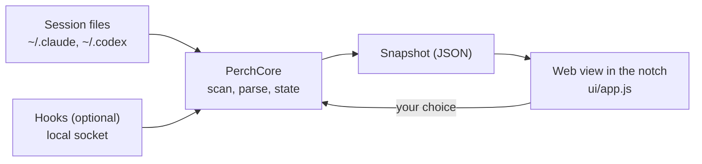

<p align="center">
  
</p>

<h1 align="center">Perch</h1>

<p align="center">
  <strong>Where you left off, in the notch.</strong><br>
  For people who run several Claude Code and Codex sessions at once.
</p>

<p align="center">
  
  
  
  
</p>

<p align="center">
  <a href="#features">Features</a> ·
  <a href="#install">Install</a> ·
  <a href="#shortcuts">Shortcuts</a> ·
  <a href="#privacy-and-permissions">Privacy</a> ·
  <a href="#development">Development</a>
</p>

<p align="center">
  
</p>
<p align="center"><sub>The real interface with sample data, on a wallpaper by <a href="https://www.raycast.com/wallpapers">Raycast</a>.</sub></p>

## Why Perch

Agents work while you are away, and they finish, stall or wait for an answer on their own schedule. When you come back to your Mac, Perch answers one question from the notch: **what was I doing, and what is waiting for me?** Then it gets you back in with one key.

## Features

- **Where was I.** After a break, a card drops from the notch with the session, its project, what the agent did and the next step when there is a real one. While a session works, it says what it is doing right now.
- **While you work.** When a session you are not in finishes or asks for something, the notch grows with what happened and a row of buttons. A finish folds away on its own; a request folds to small wings until you answer.
- **What needs you.** With live status on, Claude Code and Codex tell Perch the moment they finish or need your OK. Sessions that need you come first.
- **Answer from the notch.** Allow or deny a command, or pick an answer to Claude's question, without leaving what you are doing.
- **Jump back in.** One key opens the exact session: in the Claude app, in Codex, or in the terminal tab it runs in.
- **Reply.** See the agent's last message and answer it, into a terminal session or into the Claude or Codex app.
- **All sessions.** Every recent session in one list, grouped into what needs you, today and earlier, with its status at a glance. Type to filter.
- **Yours.** Pick a character and its colour. It lives behind the notch and only comes out when there is something to say.

Perch never takes the keyboard unless you ask for it, and it stays quiet about the session you are already in.

**Works with** the Claude app (Code), the Codex app, and Claude Code or Codex in any terminal, with exact tab switching in Terminal, iTerm2, Ghostty and cmux.

## Install

| Requirement | |
|---|---|
| macOS | 26 or later, on Apple silicon. A notch is optional: other displays get a small tab at the top centre. |
| Agents | The Claude app, the Codex app, or Claude Code and Codex in a terminal. |
| To build | Xcode 26 and Node 20 or later. |

**Download.** Get `Perch.zip` from the [latest release](https://github.com/asafofer/perch/releases/latest), unzip it and move Perch to Applications. Builds are not notarized yet, so the first time, right-click Perch and choose **Open**.

**Build from source.**

```bash
git clone https://github.com/asafofer/perch.git && cd perch
./scripts/make-dev-cert.sh   # once: a stable local signing identity, so macOS remembers permissions
./scripts/install.sh         # builds a release, installs it to /Applications and opens it
```

On first launch, a short setup walks you through your character, Accessibility, which apps to read, live status and on-device summaries. You can run it again from Settings.

## Shortcuts

| Action | Keys |
|---|---|
| Open the card | Hover the notch, or tap <kbd>⌘</kbd> <kbd>⌥</kbd> |
| Where was I | <kbd>⌃</kbd> <kbd>⌥</kbd> <kbd>P</kbd> |
| All sessions | <kbd>⌃</kbd> <kbd>⌥</kbd> <kbd>L</kbd>, or <kbd>←</kbd> from the card |
| Next or previous session | <kbd>↑</kbd> <kbd>↓</kbd> |
| Open the session | <kbd>Return</kbd> |
| Allow or deny | <kbd>A</kbd> / <kbd>D</kbd> |
| Answer a question | <kbd>1</kbd> to <kbd>4</kbd> |
| Reply | <kbd>R</kbd> |
| Not now (30 minutes, 2 hours, tomorrow) | <kbd>N</kbd> |
| Settings | <kbd>S</kbd> |
| Close | <kbd>Esc</kbd> |

While the notch shows something that finished or asks for you, its buttons answer to keys too, and only then: <kbd>⌘</kbd> <kbd>⌥</kbd> <kbd>Return</kbd> switches to it, <kbd>⌘</kbd> <kbd>R</kbd> replies, <kbd>⌘</kbd> <kbd>⌥</kbd> <kbd>Y</kbd> or <kbd>N</kbd> allows or denies, <kbd>⌘</kbd> <kbd>⌥</kbd> <kbd>1</kbd> to <kbd>3</kbd> answers, and <kbd>⌘</kbd> <kbd>⌥</kbd> <kbd>.</kbd> puts it away.

## Privacy and permissions

Perch reads the session files your agents already keep on your Mac and sends nothing anywhere. Summaries are written on device by Apple Intelligence; without it, Perch uses plain recaps from the transcript.

**Live status** is optional. It adds one hook entry to `~/.claude/settings.json` and `~/.codex/hooks.json` that runs `~/.config/perch/hook`, which talks to Perch over a local socket only you can use and does nothing when Perch is not running. Your files are backed up the first time as `*.before-perch`, and turning live status off removes the entries. Codex asks you once to trust a new hook.

| Permission | Used for | Without it |
|---|---|---|
| Accessibility | <kbd>⌘</kbd> <kbd>⌥</kbd>, and typing a reply into the Claude or Codex app | Replies are copied for you to paste |
| Automation | Switching to the exact terminal tab and typing a reply into it | The terminal comes forward and you find the tab |
| Files | Reading project folders (macOS asks once per folder) | That project is skipped |
| Apple Intelligence | On-device summaries | Plain recaps from the transcript |

## How it works



A native AppKit shell owns the notch panel, hotkeys and the hook socket. `PerchCore` decides everything (which sessions show, their status, what the notch does) and is fully tested. The interface is a small web view that only draws the snapshot it is given and reports what you chose.

## Development

Read [AGENTS.md](AGENTS.md) first: architecture, workflow, design rules and known pitfalls.

```bash
cd ui && npm install && cd ..           # once
swift test                              # logic tests
./scripts/run.sh --show                 # build, launch and open the card
cd ui && python3 -m http.server 8765    # then open http://localhost:8765/design.html
```

`ui/design.html` is the real interface with sample data and every state on one page. New UI is designed there first.

| Path | Contents |
|---|---|
| `Sources/PerchCore` | State machine, geometry, session scanning, transcript parsing, live status. Pure and tested. |
| `Sources/Perch` | The AppKit shell: panel, web view, hotkeys, hook socket, on-device summaries. |
| `ui/` | The interface: plain JavaScript and Tailwind, Inter bundled. |
| `scripts/` | Run, package, install, signing certificate, app icon and the README GIF. |

<details>
<summary><strong>Troubleshooting</strong></summary>

- **The card never appears on its own.** It waits until you have been away for the "Come back after" time, 20 minutes by default. To test it quickly: `./scripts/run.sh --idle 15`.
- **macOS asks for permissions after every build.** Run `./scripts/make-dev-cert.sh` once so builds are signed with a stable identity.
- **Accessibility is on but Perch still waits.** Remove Perch from the list with the minus button, add it again and restart Perch. Setup has a Restart button for this.
- **The list is empty.** `.build/debug/Perch --dump` prints what Perch finds in `~/.claude/projects` and `~/.codex/sessions`, and which sessions are running in a terminal. Headless runs (`claude -p`, `codex exec`) are not listed.
- **Status lags or guesses.** Turn on live status in Settings. Without it Perch reads the transcripts, which can only guess when an agent is waiting for you.

</details>

<details>
<summary><strong>Release tooling</strong></summary>

| Script | What it does |
|---|---|
| `./scripts/package.sh` | Builds a release and writes `build/Perch.zip` for sharing. |
| `./scripts/make-icon.sh` | Renders `docs/assets/icon.svg` into the app icon and `icon.png`. |
| `./scripts/record.sh` | Films the design page's sample flow into `docs/assets/perch.gif`. Needs `ffmpeg` and an unlocked screen. |

</details>

## Roadmap

- Claude-quality summaries when the `claude` CLI is signed in
- More sources: OpenCode, pi, herdr
- Notarized releases with automatic updates
- An optional sound and haptics

## Credits

Wallpapers by [Raycast](https://www.raycast.com/wallpapers). The working orb is [Thinking Orbs](https://thinkingorbs.com) by Yogesh (MIT). Set in [Inter](https://rsms.me/inter/).
