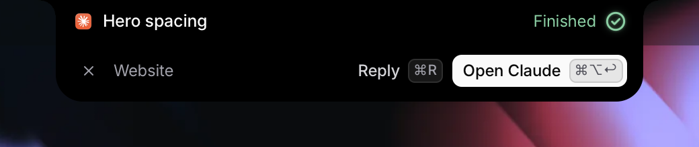
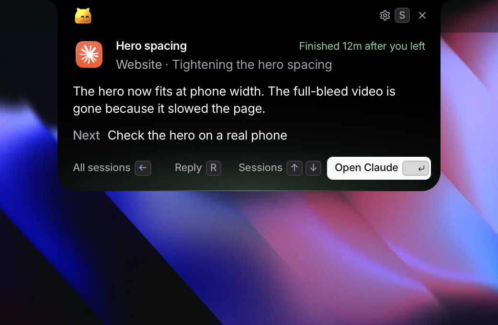
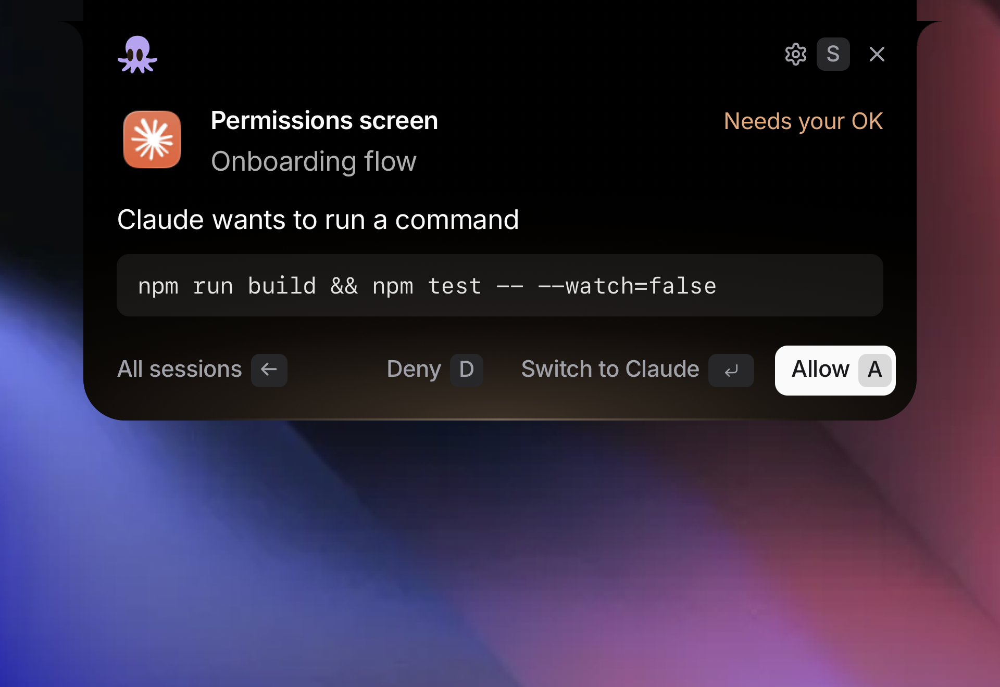
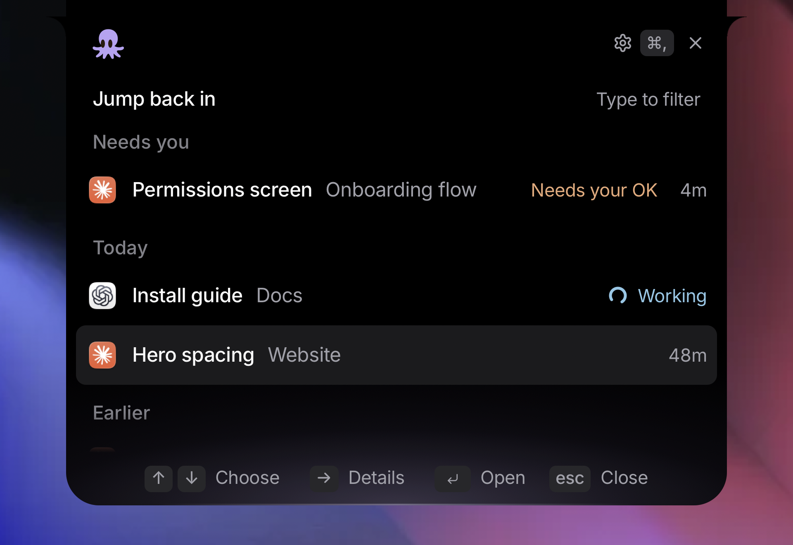

<p align="center">
  
</p>

<h1 align="center">Perch</h1>

<p align="center">
  A notch app for macOS that shows where you left off in Claude Code and Codex, in their apps or any terminal,<br>
  and lets you switch back, reply or answer without leaving the notch.
</p>

<p align="center">
  
  
  
</p>

<p align="center">
  
</p>
<p align="center">
   &nbsp;
  
</p>
<p align="center">
  
</p>
<p align="center"><sub>Wallpaper by <a href="https://www.raycast.com/wallpapers">Raycast</a>.</sub></p>

## Overview

Developers run several agent sessions at once and lose their place when they step away. Perch lives in the notch and answers one question when you come back: **what was I doing, and what is waiting for me?**

- **Where was I.** After a break, a card drops from the notch: the session, its project and what you were doing, what the agent did, and the next step when there is a real one. While a session works, the card says what it is doing right now.
- **While you work.** When a session you are not in finishes or asks for something, the notch grows with its name and what happened, and a row of buttons: switch to it, reply, allow or deny, or a question's answers. A finish folds away after a few seconds; a request folds to small wings until you answer.
- **What needs you.** With live status on, Claude Code and Codex tell Perch the moment they finish or need your OK, and sessions that need you come first.
- **Answer from the notch.** Allow or deny a command, or pick an answer to Claude's question, without leaving what you are doing. Codex approvals open in Codex.
- **Jump back in.** One key switches to the exact session: in the Claude app, in Codex, or in the terminal tab it runs in.
- **Reply.** Reply shows the agent's own last message and sends yours: straight into a terminal session, or into the Claude or Codex app.
- **All sessions.** Every recent session, grouped into what needs you, today and earlier, newest first. Type to filter.
- **Private by design.** Summaries are written on your Mac by Apple Intelligence. Perch reads local session files and sends nothing anywhere.
- **Yours.** Choose your character (ears, an octopus, a bao, a robot or an onigiri) and its colour in onboarding or Settings.

Perch never takes the keyboard unless you ask for it, and it stays quiet about the session you are already in.

## Requirements

| | |
|---|---|
| macOS | 26 or later, Apple silicon. A notch is optional: other screens get a small tab at the top centre. |
| Build tools | Xcode 26 and Node 20+ (for the Tailwind build) |
| Agents | The Claude app (Code), Codex, and Claude Code or Codex in a terminal (Terminal, iTerm2, Ghostty, cmux and others). Perch reads their local session files, and with live status on, adds a small hook to each. |

## Installation

**From source** (recommended while Perch is internal):

```bash
git clone https://github.com/asafofer/perch.git
cd perch
./scripts/make-dev-cert.sh   # once: a local signing certificate so macOS remembers permissions
./scripts/install.sh         # builds a release app, installs it to /Applications and opens it
```

**From a release:** download `Perch.zip` from the [latest release](https://github.com/asafofer/perch/releases/latest), unzip, then right-click `Perch.app` and choose **Open**. Builds are not notarized yet.

**Package your own build:** `./scripts/package.sh` writes `build/Perch.zip`.

On first launch Perch walks you through setup: character, Accessibility, which apps to read, live status, and on-device summaries. You can replay it any time from Settings.

**Live status** adds a hook entry to `~/.claude/settings.json` and `~/.codex/hooks.json` that runs `~/.config/perch/hook`. The hook talks to Perch over a local socket, only you can use it, and it does nothing when Perch is not running. Codex asks you once to trust a new hook. Turn it off in Settings and the entries are removed; your files are backed up the first time as `*.before-perch`.

## Usage

| Action | Shortcut |
|---|---|
| Open the card | Hover the notch (or the tab) |
| Open or close Perch | Tap Command + Option |
| Where was I | Control + Option + P |
| All sessions | Control + Option + L |
| Between the card and the list | Left and Right (or Tab) |
| Open the session | Return |
| Allow or deny what the agent asks | A or D |
| Pick an answer to a question | 1 to 4 |
| Reply, then scroll the agent's message | R, then Up and Down |
| Not now (30 min, 2 hours, tomorrow) | N |
| Settings (Left goes back) | S, or Command + comma in the list |
| Close | Esc |

While the notch shows something that finished or asks for you, its buttons answer to keys too, and only then: Command + Option + Return switches to it, Command + R replies, Command + Option + Y or N allows or denies, Command + Option + 1 to 3 picks an answer, and Command + Option + period puts it away.

The menu bar item also offers the card, all sessions, app choices, character, setup and quit.

## Permissions

| Permission | Why | Without it |
|---|---|---|
| Accessibility | Command + Option, and typing a reply into the Claude or Codex app | A reply is copied for you to paste |
| Automation (your terminal) | Going back to the exact tab, and typing a reply into it | The terminal comes forward; you find the tab |
| Files | Reading project folders (macOS asks once per folder) | That project is skipped |
| Apple Intelligence | On-device summaries (optional) | Plain recaps from the transcript |

If Accessibility is switched on but Perch still shows "waiting", remove Perch from the list with the minus button, add it again and restart Perch. Onboarding has a Restart button for this.

## Development

Start with [AGENTS.md](AGENTS.md): architecture, workflow, design rules and known pitfalls.

```bash
cd ui && npm install && cd ..
swift test                              # logic tests
./scripts/run.sh --show                 # build, launch and show the card
cd ui && python3 -m http.server 8765    # then open http://localhost:8765/design.html
```

`ui/design.html` is the real interface with sample data and every state on one page. New UI is designed there first.

| Path | Contents |
|---|---|
| `Sources/PerchCore` | State machine, geometry, transcript parsing, recaps, live status from hooks. Pure and tested. |
| `Sources/Perch` | AppKit shell: panel, web view, hotkeys, session scanning, the hook socket, on-device summaries. |
| `ui/` | The interface: plain JavaScript, Tailwind and shadcn-style classes, Inter. |
| `scripts/` | Build, run, package, install and certificate scripts. |

## Troubleshooting

- **The card never appears on its own.** It needs you to be away for the "Come back after" time (20 minutes by default). To test quickly: `./scripts/run.sh --idle 15`.
- **macOS asks for permissions again after every build.** Run `./scripts/make-dev-cert.sh` once so builds are signed with a stable identity.
- **The list is empty.** `.build/debug/Perch --dump` prints what Perch finds in `~/.claude/projects` and `~/.codex/sessions`, and which sessions are running in a terminal. Claude app sessions, Codex threads, and sessions started in a terminal are listed; headless runs (`claude -p`, `codex exec`) are not.
- **See the notch while you work.** `./scripts/run.sh --activity` plays a finish, a command to allow and a question over your real sessions.
- **Status lags or guesses.** Turn on Live status in Settings. Without it Perch reads the transcripts, which can only guess when an agent is waiting for you.
- **README screenshots.** `./scripts/run.sh --snapshot docs/assets --wallpaper ui/wallpapers/blue-distortion-1.webp`.

## Roadmap

Claude-quality summaries, sending a reply into the Claude app without bringing it forward, notarized releases, more sources (Cursor). See [AGENTS.md](AGENTS.md).
