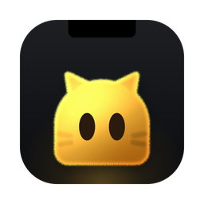
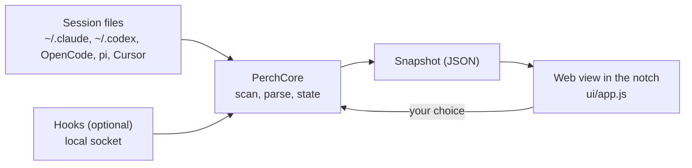

<p align="center">
  
</p>

<h1 align="center">Perch</h1>

<p align="center">
  <strong>The fastest way back to your agents.</strong><br>
  See when Claude Code, Codex, OpenCode, pi or Cursor finish or need you, answer them from your Mac’s notch, and jump back to the exact session.
</p>

<p align="center">
  
  
  
</p>

<p align="center">
  <a href="https://perchapp.dev">perchapp.dev</a> ·
  <a href="#features">Features</a> ·
  <a href="#install">Install</a> ·
  <a href="#shortcuts">Shortcuts</a> ·
  <a href="#privacy-and-permissions">Privacy</a> ·
  <a href="#development">Development</a>
</p>

<p align="center">
  <a href="https://github.com/asafofer/perch-releases/releases/latest/download/Perch.dmg"></a><br>
  <sub>macOS 15+ on Apple silicon · Free and MIT · Local-only, no account · Signed and notarized by Apple</sub>
</p>

<p align="center">
  
</p>
<p align="center"><sub>The real interface with sample data, on a wallpaper by <a href="https://www.raycast.com/wallpapers">Raycast</a>.</sub></p>

## Why Perch

Agents work while you are away, and they finish, stall or wait for an answer on their own schedule. When you come back to your Mac, Perch answers one question from the notch: **what was I doing, and what is waiting for me?** Then it gets you back in with one key.

## Features

- **Where was I.** After a break, a card drops from the notch with the session, what the agent did and the next step, if there is one.
- **While you work.** When a session you are not in finishes or asks for something, the notch grows with what happened and a row of buttons. A finish folds away on its own; a request waits as small wings until you answer.
- **What needs you.** With live status on, Claude Code, Codex, OpenCode, pi and Cursor tell Perch the moment they finish or need your OK. Sessions that need you come first.
- **Answer from the notch.** Allow or deny a command, or pick an answer to Claude's or OpenCode's question, without leaving what you are doing.
- **Jump back in.** One key opens the exact session: in the Claude app, in Codex, in the terminal tab it runs in, or the exact herdr or tmux pane, cmux split or agterm pane. A session that has ended opens again where it last ran.
- **Reply.** See the agent's last message and answer it, into a terminal session or into the Claude or Codex app.
- **All sessions.** Every recent session in one list, grouped into what needs you, today and earlier, with its status at a glance. Type to filter.
- **Yours.** Pick a character and its colour. It lives behind the notch and only comes out when there is something to say.

Perch never takes the keyboard unless you ask for it, and it stays quiet about the session you are already in.

**Works with** the Claude app (Code), the Codex app, [Conductor](https://conductor.build) (its Claude Code and Codex workspaces), [Cursor](https://cursor.com) (its agent chats, beta: tried with Cursor 3.23 and its Agents window), and Claude Code, Codex, [OpenCode](https://opencode.ai) or [pi](https://pi.dev) in any terminal, with exact tab switching in Terminal, iTerm2, Ghostty and Warp, and the exact split or pane in cmux, [agterm](https://github.com/umputun/agterm), [herdr](https://herdr.dev) and tmux.

## Install

| Requirement | |
|---|---|
| macOS | 15 (Sequoia) or later, on Apple silicon. A notch is optional: other displays get a small tab at the top centre. |
| Agents | The Claude app, the Codex app, Cursor, Conductor, or Claude Code, Codex, OpenCode and pi in a terminal (herdr, tmux, cmux and agterm included). |
| To build | Xcode 26 or later and Node 20 or later. |

**Download.** Get `Perch.dmg` from the [latest release](https://github.com/asafofer/perch-releases/releases/latest), open it and drag Perch onto Applications. It's signed and notarized by Apple, so it opens like any app. Perch checks for updates every hour and shows a quick peek in the notch when one is ready; press Update and it installs when nothing is on screen.

**Build from source.**

```bash
git clone https://github.com/asafofer/perch.git && cd perch
./scripts/make-dev-cert.sh   # once: a stable local signing identity, so macOS remembers permissions
./scripts/install.sh         # builds a release, installs it to /Applications and opens it
```

On first launch, a short setup walks you through your character, Accessibility, which apps to read and live status. You can run it again from Settings.

## Shortcuts

| Action | Keys |
|---|---|
| Open the card | Hover the notch, or tap <kbd>⌘</kbd> <kbd>⌥</kbd> |
| Where was I | <kbd>⌃</kbd> <kbd>⌥</kbd> <kbd>P</kbd> |
| All sessions | <kbd>⌃</kbd> <kbd>⌥</kbd> <kbd>L</kbd>, or <kbd>←</kbd> from the card |
| Next or previous session | <kbd>↑</kbd> <kbd>↓</kbd> |
| Open the session | <kbd>Return</kbd> |
| Allow or deny | <kbd>A</kbd> / <kbd>D</kbd> |
| Answer a question | <kbd>1</kbd> to <kbd>4</kbd> |
| Reply | <kbd>R</kbd> |
| Not now (30 minutes, 2 hours, tomorrow) | <kbd>N</kbd> |
| Settings | <kbd>⌘</kbd> <kbd>,</kbd> |
| Close | <kbd>Esc</kbd> |

While the notch shows something that finished or asks for you, its buttons answer to keys too, and only then: <kbd>⌘</kbd> <kbd>⌥</kbd> <kbd>Return</kbd> switches to it, <kbd>⌘</kbd> <kbd>R</kbd> replies, <kbd>⌘</kbd> <kbd>⌥</kbd> <kbd>Y</kbd> or <kbd>N</kbd> allows or denies, <kbd>⌘</kbd> <kbd>⌥</kbd> <kbd>1</kbd> to <kbd>3</kbd> answers, and <kbd>⌘</kbd> <kbd>⌥</kbd> <kbd>.</kbd> puts it away.

## Privacy and permissions

Perch reads the session files your agents already keep on your Mac, and your sessions, prompts and code never leave it. There is no account, analytics or telemetry. Perch goes online for two things only:

- **Updates.** About once an hour it fetches the release list, `appcast.xml` in the public [perch-releases](https://github.com/asafofer/perch-releases) repo on GitHub, and downloads a new version only when you press Update.
- **Send feedback,** when you use it. Your message, any screenshots you attach, your email if you give one and, if you choose, the Perch and macOS versions go to a small function (`feedback/`, on Vercel) that emails them to the maker of Perch.

The card's words are your agents' own: the session's title, what the agent said it did, and a next step only when the agent stated one.

**Live status** is optional. It adds one hook entry to `~/.claude/settings.json` and `~/.codex/hooks.json` that runs `~/.config/perch/hook`, and for Cursor four entries in `~/.cursor/hooks.json`, and for OpenCode and pi a plugin file of Perch's own (`~/.config/opencode/plugins/perch.js`, `~/.pi/agent/extensions/perch.ts`). They talk to Perch over a local socket only you can use and do nothing when Perch is not running. Your config files are backed up the first time as `*.before-perch`, and turning live status off removes the entries and files. Codex asks you once to trust a new hook.

| Permission | Used for | Without it |
|---|---|---|
| Accessibility | <kbd>⌘</kbd> <kbd>⌥</kbd>, and typing a reply into the Claude or Codex app | Replies are copied for you to paste |
| Automation | Switching to the exact terminal tab or cmux split and typing a reply into it | The terminal comes forward and you find the tab |
| Files | Reading project folders (macOS asks once per folder) | That project is skipped |

## How it works



A native AppKit shell owns the notch panel, hotkeys and the hook socket. `PerchCore` decides everything (which sessions show, their status, what the notch does) and is fully tested. The interface is a small web view that only draws the snapshot it is given and reports what you chose.

## Development

Read [AGENTS.md](AGENTS.md) first: architecture, workflow, design rules and known pitfalls. [CONTRIBUTING.md](CONTRIBUTING.md) says how a change goes in and what CI checks.

```bash
cd ui && npm install && cd ..           # once
swift test                              # logic tests
./scripts/run.sh --show                 # build, launch and open the card
cd ui && python3 -m http.server 8765    # then open http://localhost:8765/design.html
```

`ui/design.html` is the real interface with sample data and every state on one page. New UI is designed there first.

| Path | Contents |
|---|---|
| `Sources/PerchCore` | State machine, geometry, session scanning, transcript parsing, live status. Pure and tested. |
| `Sources/Perch` | The AppKit shell: panel, web view, hotkeys, hook socket. |
| `ui/` | The interface: plain JavaScript and Tailwind, Inter bundled. |
| `scripts/` | Run, package, install, signing certificate, app icon and the README GIF. |
| `feedback/` | The small Vercel function Send feedback posts to; it emails the message on. |

<details>
<summary><strong>Troubleshooting</strong></summary>

- **The card never appears on its own.** It waits until you have been away for the "Come back after" time, 20 minutes by default. To test it quickly: `./scripts/run.sh --idle 15`.
- **macOS asks for permissions after every build.** Run `./scripts/make-dev-cert.sh` once so builds are signed with a stable identity.
- **Perch asks for Accessibility again after an update.** 0.4.0 is the first release signed by Apple, and macOS ties Accessibility to the signature, so it asks once more. Press Allow on the What's new card (or in Settings) and turn Perch on in System Settings.
- **Accessibility is on but Perch still waits.** Remove Perch from the list with the minus button, add it again and restart Perch. Setup has a Restart button for this.
- **The list is empty.** `.build/debug/Perch --dump` prints what Perch finds in `~/.claude/projects`, `~/.codex/sessions`, OpenCode's database, `~/.pi/agent/sessions` and `~/.cursor/projects`, and which agents are running, in which terminal, herdr or tmux pane or cmux split. Headless runs (`claude -p`, `codex exec`) are not listed; `pi -p` and `opencode run` save sessions like any other, so they are.
- **Status lags or guesses.** Turn on live status in Settings. Without it Perch reads the transcripts, which can only guess when an agent is waiting for you.
- **Something else is wrong, or you have an idea.** Settings, Send feedback: your words and any screenshots go straight to the maker of Perch, with your email if you'd like an answer.

</details>

<details>
<summary><strong>More scripts</strong></summary>

| Script | What it does |
|---|---|
| `./scripts/package.sh` | Builds a release and writes `build/Perch.zip` for sharing. |
| `./scripts/make-icon.sh` | Renders `docs/assets/icon.svg` into the app icon, `icon.png` and the README's `icon-256.png`. |
| `./scripts/record.sh` | Films the design page's sample flow into `docs/assets/perch.gif`. Needs `ffmpeg`; headless. |
| `./scripts/agents-demo.sh` | herdr with pi, OpenCode, Claude Code and Codex side by side, and pi alone, in cmux, for trying Perch live. |

</details>

## Roadmap

- More sources: Cursor
- An optional sound and haptics

## Credits

Wallpapers by [Raycast](https://www.raycast.com/wallpapers). The working orb is [Thinking Orbs](https://thinkingorbs.com) by Yogesh (MIT). Set in [Inter](https://rsms.me/inter/) (SIL Open Font License 1.1, `ui/dist/fonts/OFL.txt`).

## License

[MIT](LICENSE).
<!-- pull request status test 2 -->
